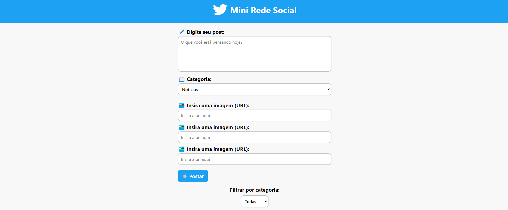

# Mini Rede Social · Web Development

| Integrante | RM |
|---|---|
| [Guilherme Santos Nunes](https://github.com/sannunez) | RM558989 |
| [Henry Evideira Paulo](https://github.com/Hep4xl0) | — |
| [Kaique Zaffarani](https://github.com/Z4ffarani) | RM556677 |

Checkpoint 3 · 2024.1 · Engenharia de Software · FIAP

---

## Esta entrega: Web Development

**Mini Rede Social** é um site que imita uma rede social, permitindo a criação de publicações categorizadas com imagens e textos. Os usuários podem visualizar, filtrar, editar e excluir posts, além de alternar entre as categorias usando carrosséis para exibição de múltiplas imagens.

As categorias presentes são:
- **Notícias** | Para postagens de informações atuais relevantes.
- **Dicas** | Para conselhos e sugestões sobre variados assuntos.
- **Eventos** | Para registros de momentos cotidianos ou especiais.

## Prévia



## Como executar

```bash
git clone https://github.com/Z4FFARANI-EDUCATIONAL/2024-SEM1-CP3-WEB-DEVELOPMENT.git
cd 2024-SEM1-CP3-WEB-DEVELOPMENT/site
```

Depois, abra o arquivo `index.html` no navegador.

## Funções

- **Criação de posts** | O usuário pode criar um post, adicionando texto, selecionando uma categoria e inserindo até três URLs (localizador uniforme de recursos) de imagens.
- **Carrossel de imagens** | Para cada post criado, as imagens associadas são exibidas em um carrossel interativo.
- **Data e hora** | Cada post é registrado com a data e hora da publicação.
- **Filtro por categoria** | É possível filtrar os posts por categoria específica ou visualizar todos simultaneamente.
- **Edição de posts** | O usuário pode editar o conteúdo de um post após sua criação.
- **Exclusão de posts** | O usuário pode apagar um post quando quiser.

## Observações

- Se uma imagem não for fornecida, um `placeholder` padrão será exibido.
- O projeto segue uma estrutura simples utilizando HTML, CSS e JavaScript. Os arquivos principais ficam na pasta `site`: `index.html`, `style.css` e `script.js`.
- O layout do site utiliza unidades relativas para margem e tamanho de fonte.
- O projeto pode ser facilmente expandido para incluir funcionalidades mais avançadas, como interações entre usuários, curtidas em posts e comentários.

---

## Tecnologias

[](https://developer.mozilla.org/pt-BR/docs/Web/HTML)
[](https://developer.mozilla.org/pt-BR/docs/Web/CSS)
[](https://developer.mozilla.org/pt-BR/docs/Web/JavaScript)

---

## Agradecimentos

- [Caio Vinícius Gonçalves de Oliveira](https://github.com/caiooliveira-tech)
